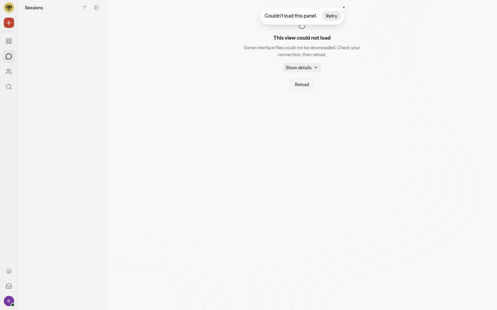
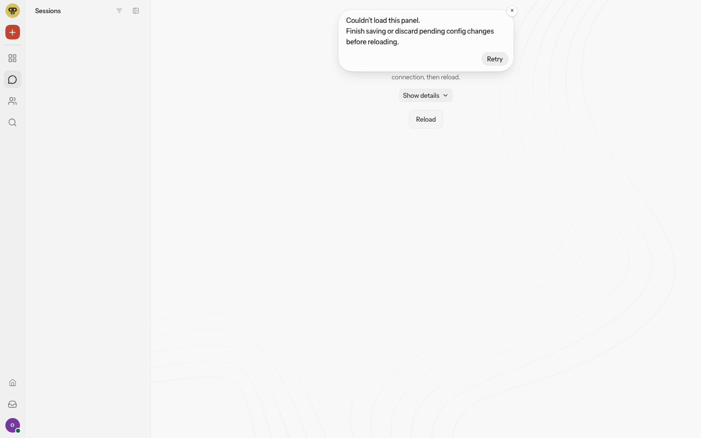

# Real Control UI evidence for issue194730

Before: upstream `94d45c8d5144dacde3e76ef1bab8046e9523b66b` production UI.
After: `7ac8a2785ad1ba513700a9039bb87b8e67ac6e81` (same production bytes as the independently reviewed final patch).

Both images are actual Chromium screenshots of the built Control UI at1440x900. Synthetic config and Gateway RPC only; the static HTTP handler and retired assets are real. No user data, credentials, private logs, database or fabricated UI is included. Parent and implementing worker inspected both PNGs.

See [results](results.md) for the exact scenario and limits.
