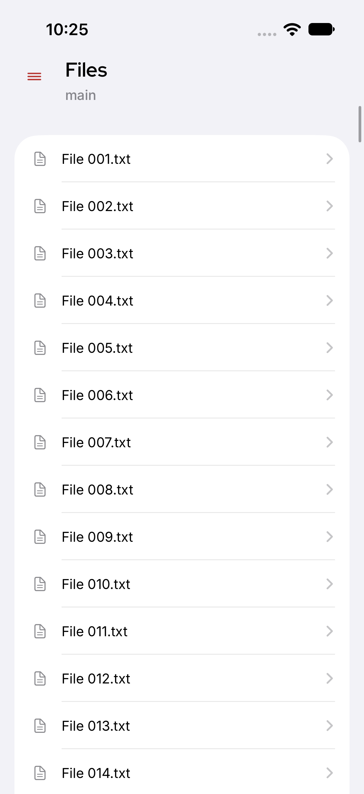
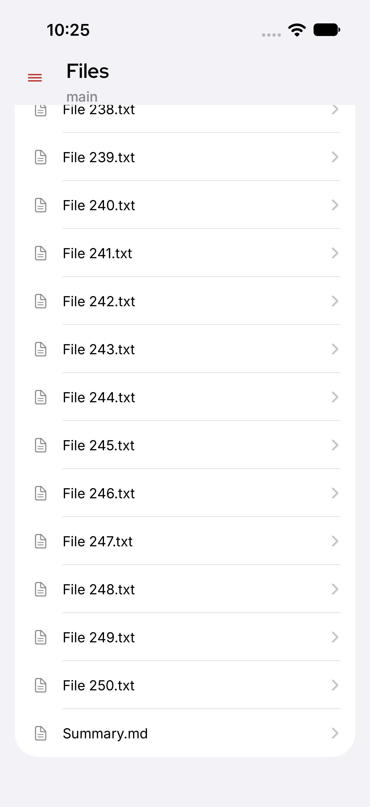

# Native iOS pagination recovery proof for PR fixing #193278

Exact product source: `df5aa27ae39e2eb9c81914102ed0021f6731730b`. Original synthetic iPhone17/iOS27.0 XCTest captures, English, Light mode, inspected before publication. No production/user files or private logs are included.

The native case uses the production-default250+1 entries. Initial250distinct paths and native250of251 were followed by two failed offset250 retries and a successful offset250 response containing Summary.md. It passed once (0failures/0skips); case182.305s, command212.677s. Native checks cover representative first/last originals, one final Summary.md, Load More removed and old error absent. This is not exhaustive UI row enumeration or real Gateway filesystem/hardware proof. See [sanitized results](results.json).

## Recovered directory: old error absent, original rows remain

## Last file loaded: Summary.md present and no Load More

The initial accessibility14vs250 oracle failure was a setup/oracle error, not a product reproduction. The actual base run failed only after the successful final file load because the old error remained; the candidate passes that same assertion. Query-only footer handling avoids absent-element lookup retries. The full typography suite remains an unrun known host-file-open limitation.
