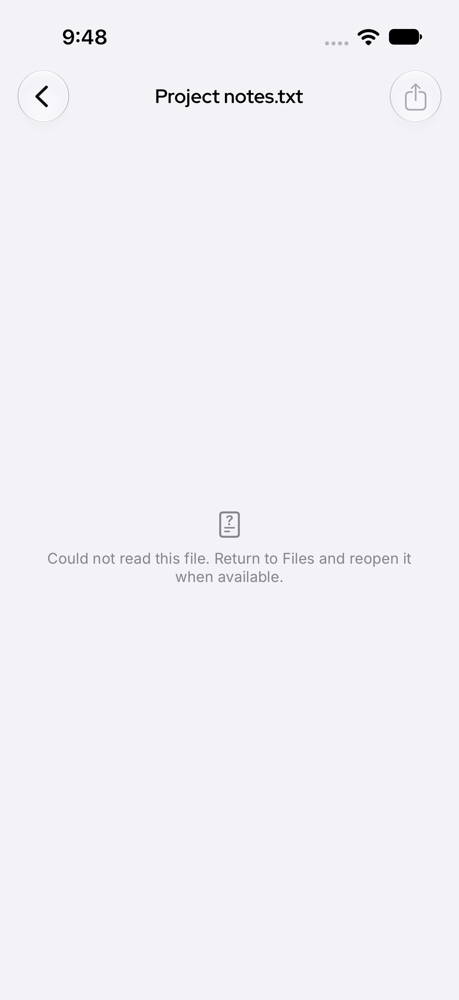
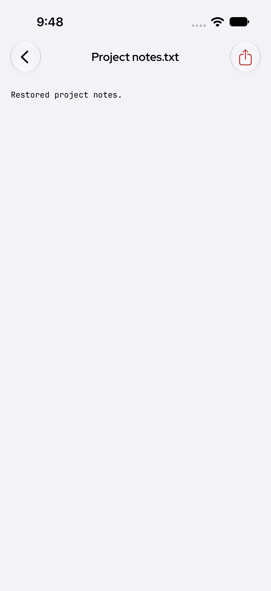
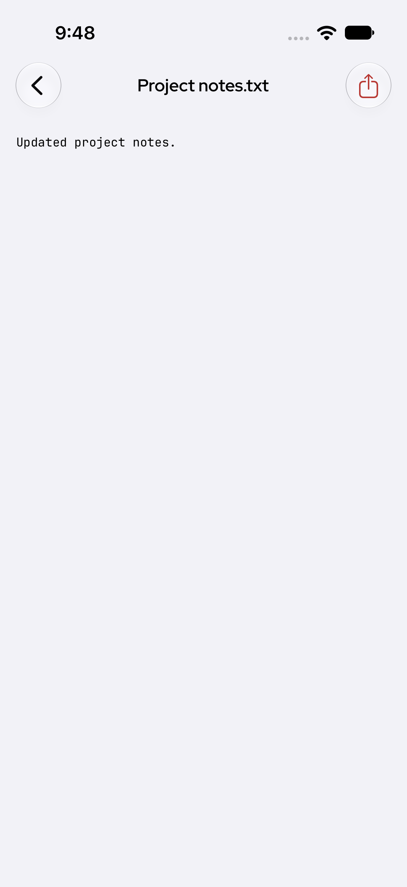

# Native iOS proof for PR #193450

These original after-fix iPhone 17 / iOS 27.0 simulator screenshots were captured by XCTest against synthetic loopback RPC. No production Gateway or real user content was used. They were inspected before publication. This is evidence for the exact source commit `47a1db818cfe41bc67e64286e5d3516b01153ff9`.

The fresh native case passed once with all six ordered phases (missing, restored, too-large, unsupported, unavailable, updated), 0 failures and 0 skips. These are six controls in one case, not six unique tests. Test case: 59.797 seconds; command: 106.399 seconds. See [sanitized machine-readable summary](test-summary.json).

## Missing file: actionable guidance and Share disabled

## Same file restored: actual text and Share enabled

## Same file updated: current text and Share enabled

The test also checks size/format controls, ordinary read failure and stale-content/error prevention. Full raw host logs, credentials, local paths and unrelated artifacts are excluded. This does not establish a real Gateway outage, hardware, release-signing or App Store behavior.
