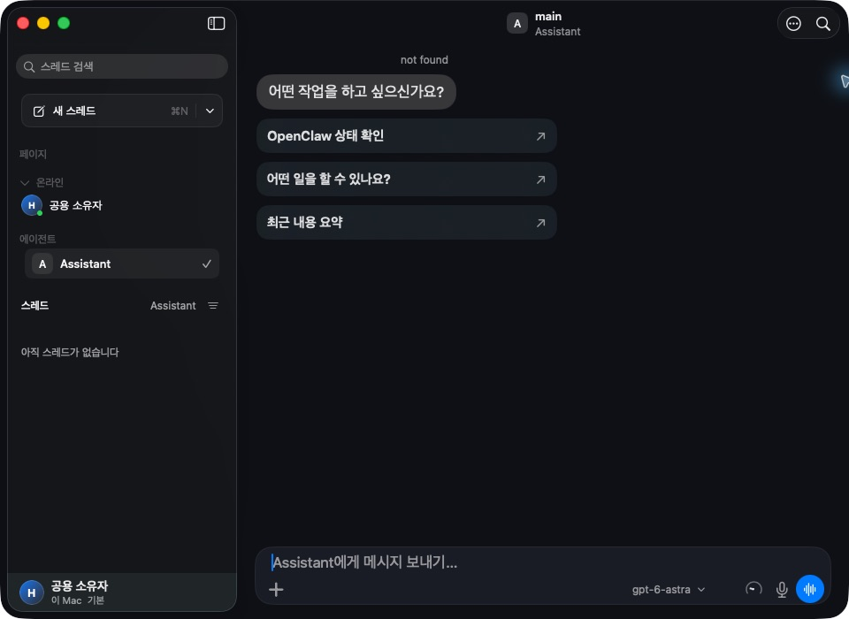
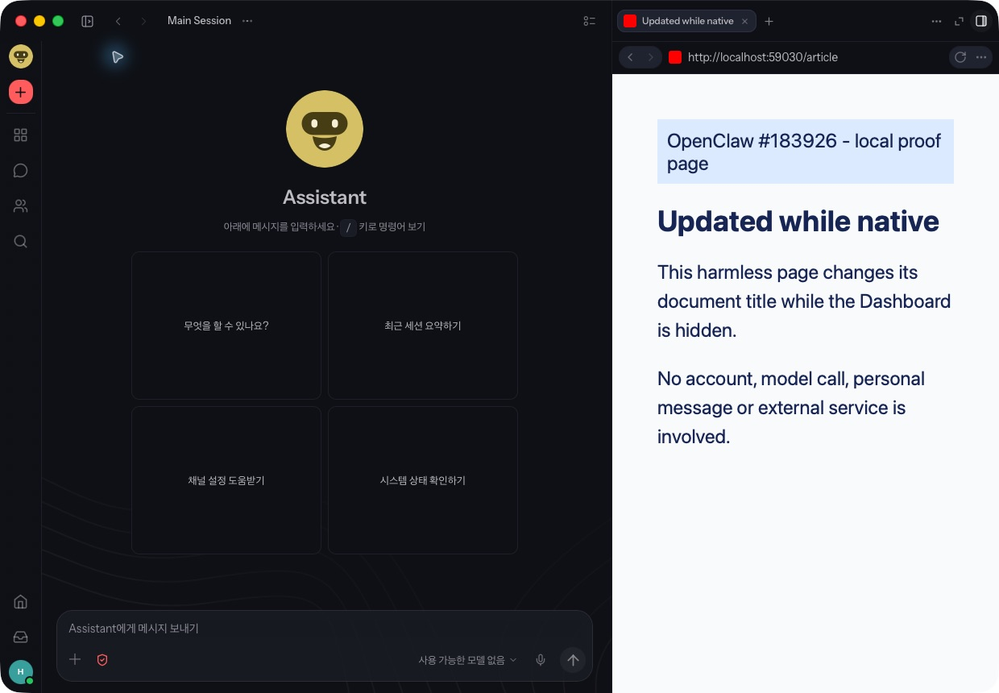

# PR #184537: actual macOS app UI evidence

PR: https://github.com/openclaw/openclaw/pull/184537
Exact app source: `a09f3aec3c1035d3fa8d115b57898b7923090c2a`.

This is the real macOS app built with its official packaging script, not an in-process test harness or a mock Dashboard. Build: debug, arm64, ad-hoc signed; the unrelated local MLX voice helper was omitted. It is not a released or notarized binary.

## Observed sequence

1. In Web experience, open a harmless localhost page in a native Mac browser tab. Both the tab and page show **Article before switch**.
2. Through Settings > This Mac, enable Native experience. The real Native chat window appears and the retained Dashboard is hidden.
3. Update the local page server state. The ordinary page script changes its own `document.title`; its acknowledgement records **Updated while native** with `document.visibilityState` equal to **hidden**.
4. Through normal Settings > This Mac, disable Native experience and return to the app. The retained Mac tab and page both show **Updated while native**, without reloading the page or injecting Dashboard/native state.

Only a task-local Gateway and a task-specific app profile were used. No model was configured or invoked. Captures contain only the app window and test content; no account, private endpoint, IP address, key or personal message is shown. Original screenshot pixels are preserved, without generative editing.

### 1. Web before switching

### 2. Actual Native window while the Dashboard is hidden

### 3. Web after switching back

[Structured evidence and screenshot SHA-256 hashes](evidence.json) records the hidden-page acknowledgement. [The ordinary local page server](page-server.py) is included for inspection; it never injects app state. It binds only loopback; use the URL recorded in `repro-output/logs/page-server.json`, then POST `/update` while the Dashboard is hidden.

## What this establishes

This adds an exact-PR-head real-app UI path for the requested Web -> Native -> Web behavior. Existing red/green Swift tests remain the separate before-fix/fixed regression comparison. No before-fix application recording, broad native-suite qualification, repeated-run qualification, or loading-indicator UI proof is claimed by these screenshots.
